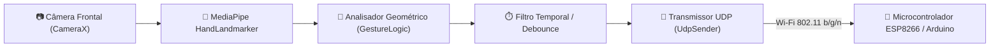

# 🐍 MEGASNAKEAPP — Controle Robótico por Visão Computacional

> Aplicativo Android para controle por gestos em tempo real de robôs educacionais via Wi-Fi (UDP), desenvolvido para a equipe de robótica **SESI MEGASNAKES** (FTC / FLL — CE332 Boituva).

---

## 📑 Índice

- [🧠 Visão Geral](#-visão-geral)
- [🏗️ Arquitetura do Sistema](#️-arquitetura-do-sistema)
- [⚙️ Funcionamento e Gestos](#️-funcionamento-e-gestos)
- [📂 Estrutura de Arquivos](#-estrutura-de-arquivos)
- [🛠️ Pré-requisitos e Instalação](#️-pré-requisitos-e-instalação)
- [💻 Como Executar](#-como-executar)
- [🧪 Testes](#-testes)
- [🔍 Análise Técnica e Métricas](#-análise-técnica-e-métricas)
- [🐛 Solução de Problemas](#-solução-de-problemas)
- [🛡️ Privacidade e Segurança](#️-privacidade-e-segurança)
- [👥 Sobre a Equipe](#-sobre-a-equipe)

---

## 🧠 Visão Geral

O **MEGASNAKEAPP** é uma solução de interface humano-robô (HRI) baseada em inteligência artificial no dispositivo (*Edge AI*). Utilizando a câmera frontal do smartphone e visão computacional em tempo real, o aplicativo rastreia os pontos anatômicos da mão (*landmarks*) do operador e converte padrões posturais em comandos de navegação transmitidos diretamente ao robô via pacotes UDP de baixa latência.

### 🎯 Principais Objetivos

- **Engajamento STEAM**: Estimular crianças e jovens no aprendizado de robótica, programação e inteligência artificial de forma interativa e intuitiva.
- **Processamento Edge AI**: Toda a inferência de visão computacional acontece 100% no próprio dispositivo, sem depender de internet nem expor imagens de crianças a servidores remotos.
- **Comunicação em Tempo Real**: Envio de comandos imediatos via protocolo UDP diretamente para o microcontrolador ESP8266/Arduino que comanda o chassi robótico.

> 💡 **Dica:** O reconhecimento é otimizado para a câmera frontal, permitindo que a criança segure o celular ou o posicione em um suporte enquanto interage com o robô.

---

## 🏗️ Arquitetura do Sistema

A arquitetura do projeto conecta o fluxo de captura de vídeo do Android à mecânica do robô através de módulos bem definidos:



### 🧩 Componentes Centrais

- **CameraX (`CameraScreen.kt`)**: Gerencia o ciclo de vida da câmera, provendo frames estáveis para o pipeline de análise sem bloquear a thread de interface.
- **MediaPipe Hand Landmarker (`HandLandmarkerHelper.kt`)**: Carrega o modelo neural `hand_landmarker.task` e infere 21 pontos tridimensionais da mão em modo *Live Stream*.
- **Classificador Espacial (`GestureLogic.kt`)**: Calcula distâncias euclidianas relativas entre falanges, pulso e dedos, projetando o vetor do polegar em relação à orientação da mão para determinar o comando pretendido.
- **Camada de Rede (`UdpSender.kt`)**: Encapsula o identificador do comando em datagramas UDP direcionados ao socket do microcontrolador (`192.168.4.1:4210`).
- **Interface Reativa (`Jetpack Compose`)**: Telas declarativas com animações, feedback em tempo real e visual temático da equipe.

---

## ⚙️ Funcionamento e Gestos

O sistema converte a conformação geométrica da mão em códigos numéricos de comando, adotando uma tolerância temporal de **500 ms** para confirmação (*debouncing*) a fim de mitigar ruídos e disparos acidentais durante a transição entre poses.

| Gesto | Descrição Postural | Código UDP | Ação no Robô |
| :--- | :--- | :---: | :--- |
| ✋ **Palma Aberta** | 4 dedos estendidos para cima + polegar estendido | `1` | **Mover para Frente** |
| ✊ **Punho Fechado** | Todos os dedos fechados (< 1.1s) | `0` | **Parar Imediatamente** |
| 🛑 **Punho Mantido** | Todos os dedos fechados por mais de 1.1s | `4` | **Mover para Trás (Ré)** |
| 👉 **Polegar à Direita** | Dedos recolhidos com polegar esticado para a direita | `2` | **Girar para a Direita** |
| 👈 **Polegar à Esquerda** | Dedos recolhidos com polegar esticado para a esquerda | `3` | **Girar para a Esquerda** |
| ⚪ **Nenhum / Transição** | Mão fora do quadro ou em transição | `-1` | **Estado Neutro** |

> ⚠️ **Atenção:** Movimentos bruscos ou ambientes com iluminação insuficiente podem interferir na precisão do rastreador de landmarks.

---

## 📂 Estrutura de Arquivos

```
MEGASNAKEAPP/
├── 📂 app/
│   ├── 📂 src/
│   │   ├── 📂 main/
│   │   │   ├── 📂 assets/
│   │   │   │   └── 🧠 hand_landmarker.task      # Modelo neural MediaPipe pré-treinado
│   │   │   ├── 📂 java/com/example/megasnakeapp/
│   │   │   │   ├── 📱 MainActivity.kt          # Fluxo de telas e termos de uso
│   │   │   │   ├── 📷 CameraScreen.kt          # Visualização da câmera e HUD do gesto
│   │   │   │   ├── 📋 ComandosScreen.kt        # Tela instrutiva com guia de gestos
│   │   │   │   ├── 🤖 HandLandmarkerHelper.kt  # Integração com a API MediaPipe Vision
│   │   │   │   ├── 📐 GestureLogic.kt          # Algoritmo de geometria e filtro temporal
│   │   │   │   ├── 📡 UdpSender.kt             # Transmissão de pacotes via socket UDP
│   │   │   │   └── 📂 ui/theme/                # Paleta de cores, tipografia e tema
│   │   │   └── 📂 res/                         # Identidade visual, logotipos e drawables
│   │   ├── 📂 test/                            # Testes unitários (JUnit)
│   │   └── 📂 androidTest/                     # Testes instrumentados (Espresso)
│   └── 📄 build.gradle.kts                     # Dependências do módulo do aplicativo
├── 📂 APK APP/
│   └── 📦 MEGASNAKES_APP.apk                   # Pacote de instalação pré-compilado
├── 📄 build.gradle.kts                         # Configuração raiz de build Gradle
└── 📄 settings.gradle.kts                      # Declaração dos repositórios e módulos
```

---

## 🛠️ Pré-requisitos e Instalação

### 📋 Requisitos de Hardware e Software

- **Ambiente de Desenvolvimento**: Android Studio Iguana ou superior
- **JDK**: Java 11 ou superior
- **Dispositivo de Teste**: Smartphone Android com câmera frontal funcional
- **Android SDK**: `minSdk 24` (Android 7.0) e `targetSdk 36`
- **Microcontrolador**: Módulo ESP8266 ou Arduino com shield Wi-Fi configurado como Access Point (`AP Mode`)

### 🔧 Passos de Configuração do Ambiente

1. **Clonar o Repositório**:
   ```bash
   git clone https://github.com/seu-usuario/MEGASNAKEAPP.git
   cd MEGASNAKEAPP
   ```

2. **Sincronizar Dependências do Gradle**:
   Abra o projeto no Android Studio e aguarde o download das dependências do MediaPipe e do CameraX, ou execute via terminal:
   ```bash
   ./gradlew build
   ```

3. **Verificar Modelo Neural**:
   Certifique-se de que o arquivo [hand_landmarker.task](file:///home/jprogenski/Documentos/MEGASNAKEAPP/app/src/main/assets/hand_landmarker.task) está presente na pasta `app/src/main/assets/`.

---

## 💻 Como Executar

### 🚀 Opção 1: Instalação Rápida via APK Pré-compilado

Para testar diretamente sem compilar o código-fonte:
1. Conecte o smartphone Android via cabo USB com a **Depuração USB** ativada.
2. Instale o pacote disponível na pasta `APK APP`:
   ```bash
   adb install "APK APP/MEGASNAKES_APP.apk"
   ```

### 🔨 Opção 2: Compilação e Execução via Gradle

Para compilar e enviar a versão de desenvolvimento diretamente ao dispositivo:

```bash
# Compilar e instalar a variante de depuração
./gradlew installDebug

# Ou executar os testes antes da geração do APK
./gradlew check
```

### 📶 Procedimento de Conexão com o Robô

1. Ligue o robô educacional para iniciar a rede Wi-Fi do ESP8266 (ex: `MEGASNAKES-ROBOT`).
2. No celular, conecte-se à rede Wi-Fi transmitida pelo robô.
3. Abra o **MEGASNAKEAPP**.
4. Leia e confirme os Termos de Uso.
5. Na tela inicial, toque em **TUDO PRONTO**, avance pela tela de comandos e autorize a permissão de câmera.
6. Aponte a mão para a câmera frontal e controle o robô!

> 💡 **Dica:** O IP padrão do microcontrolador está configurado como `192.168.4.1` na porta `4210`. Caso seu roteador ou módulo utilize outra faixa de IP, configure os parâmetros na classe [`UdpSender`](file:///home/jprogenski/Documentos/MEGASNAKEAPP/app/src/main/java/com/example/megasnakeapp/UdpSender.kt).

---

## 🧪 Testes

O projeto conta com baterias de testes automatizados para validar a estabilidade dos fluxos e regras do app:

```bash
# Execução dos testes unitários
./gradlew test

# Execução dos testes instrumentados no dispositivo ou emulador
./gradlew connectedAndroidTest
```

### 🔬 O que é Validado

- **Lógica de Gestos**: Conversão exata dos ângulos e vetores geométricos das articulações da mão.
- **Filtro Temporal**: Garantia de que variações menores que 500 ms não provoquem oscilações nos comandos enviados.
- **Ciclo de Vida da Câmera**: Garantia de liberação adequada de recursos de hardware ao fechar ou alternar a tela.

---

## 🔍 Análise Técnica e Métricas

- **Latência de Inferência**: Média de 25 ms a 40 ms por frame em dispositivos intermediários via MediaPipe LiveStream.
- **Consumo de Banda**: Praticamente insignificante (< 100 bytes/s), já que apenas o código numérico do comando ativo é despachado via UDP.
- **Processamento Concorrente**:
  - `ImageAnalysis` executado em pipeline desacoplado através de executor dedicado.
  - Sockets de rede despachados através de Coroutines no despachante `Dispatchers.IO`.

---

## 🐛 Solução de Problemas

| Sintoma | Causa Mais Provável | 🛠️ Solução Recomendada |
| :--- | :--- | :--- |
| **Gesto não é reconhecido** | Mão muito próxima ou fora do campo visual | Mantenha a mão a uma distância de 40 cm a 80 cm da câmera frontal. |
| **Robô não responde aos comandos** | Smartphone desconectado da rede Wi-Fi do ESP | Verifique nas configurações do Android se a conexão Wi-Fi do robô está ativa. |
| **Comandos invertidos (Esquerda/Direita)** | Orientação da câmera frontal espelhada | Ajuste o sinal da condição `sideValue` em [`GestureLogic.kt`](file:///home/jprogenski/Documentos/MEGASNAKEAPP/app/src/main/java/com/example/megasnakeapp/GestureLogic.kt#L67-L71). |
| **Tela preta ao abrir a câmera** | Permissão de câmera negada | Acesse `Configurações > Aplicativos > MEGASNAKEAPP > Permissões` e ative o acesso à Câmera. |
| **Comandos oscilando rapidamente** | Ruído ou trepidação durante o gesto | O limiar temporal padrão é de 500 ms; ajuste `CONFIRMATION_MS` se necessário. |

---

## 🛡️ Privacidade e Segurança

- 🔒 **Privacidade 100% On-Device**: Nenhum registro audiovisual (foto, vídeo ou áudio) é armazenado, processado em nuvem ou transmitido pela rede.
- ⚡ **Descarte Imediato**: Os frames de imagem recebidos pela câmera são analisados diretamente na memória volátil pelo MediaPipe e descartados instantaneamente.
- 🚸 **Foco Educacional Infantil**: Em conformidade com boas práticas de proteção de dados infantis em projetos STEM educacionais.

---

## 👥 Sobre a Equipe

O **SESI MEGASNAKES** é uma equipe de robótica do **SESI CE332 de Boituva/SP**, fundada em 2013. O nome homenageia as origens de Boituva — termo de origem Tupi-Guarani que significa *"Muitas Cobras / Grandes Cobras"*.

- 🏆 **Trajetória Internacional**: Participação destacada em torneios nacionais e 3 participações em torneios mundiais de robótica da FIRST (FLL / FTC).
- 🤝 **Missão STEAM**: Democratizar o acesso à tecnologia e à programação através de soluções lúdicas e inspiradoras.

---

<p align="center">
  <b>SESI MEGASNAKES • Boituva - SP</b><br>
  <i>Transformando o mundo através da robótica e da educação.</i>
</p>
